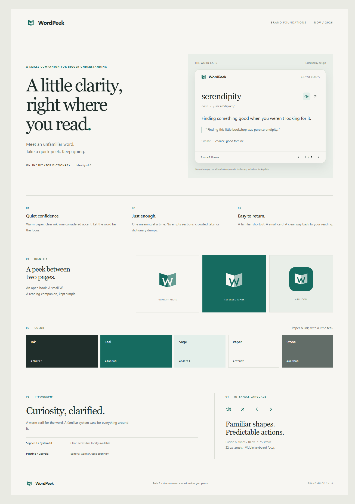

# WordPeek

**A little clarity, right where you read.**

An online-first desktop dictionary for people learning English. Select a word,
press a shortcut, and see a compact HTML/CSS card: one meaning, pronunciation,
an example, and relevant synonyms and antonyms. Move through meanings with **‹ / ›**.
Search with your chosen engine or custom URL in your default browser when you want more.

**Status: early Windows prototype, not a stable release.** No browser extension.
Selection capture depends on the host app's Windows accessibility support. Unsupported
apps can use manual entry. Optional automatic selection cards appear without taking
focus; click to interact and drag the header to move the card. Native context-menu
integration remains deferred.

## Run locally

Requires Windows 10/11, Node.js 24 LTS, npm, and an internet connection. No Rust/C++
toolchain or API key is required. The build compiles a small native helper using
the Windows .NET Framework 4.x compiler and UI Automation/System.Speech assemblies.

```sh
npm ci
npm run dev
```

Select a short English word in another application and press **Ctrl+Alt+W**.
Change the shortcut through the gear button. WordPeek runs in the system tray;
Escape or loss of focus hides it, and **Quit WordPeek** in the tray exits.

```sh
npm run check        # format, lint, tests, typecheck, production frontend build
npm run test:desktop # live desktop smoke test (interactive Windows)
npm run build
npm start            # production desktop app
npm run package:win  # unsigned, per-user Windows installer in release/
```

`npm run dev:web` previews the interface in a browser for UI development only;
global shortcuts, native selection, dismissal, and settings persistence require
the desktop app. macOS/Linux builds are not supported yet.

## What is shown

- One dictionary sense per page, with its part of speech and phonetic text.
- Pronunciation tries provider recordings, then a clearly labeled Windows system voice.
- One example, up to three synonyms, and up to three antonyms when available.
- Meaning navigation only when there is more than one sense.
- Configurable web search and expandable source/license information.
- Grouped Settings: Appearance, Triggers, Word details, and Search.
- Independently enable keyboard and automatic triggers, and choose which detail fields appear.
- Tray quick settings for appearance, search engine, and triggers; a direct Settings entry.

Missing enabled information is briefly identified. Broader part-of-speech relations
are labeled; examples and relations are never fabricated. Meanings retain provider order; the app
does not infer the intended meaning from a surrounding sentence.

## Online sources & privacy

The first provider is [Free Dictionary API](https://dictionaryapi.dev/), which
returns Wiktionary-derived content. It is a public service without an uptime
guarantee; failed lookups show actionable errors. See [source policy](docs/data-sources.md).
Only the looked-up word/phrase goes to the provider, including automatic lookups
when you enable that trigger. Audio is requested
only on playback. Your chosen search website receives the word when you press Search.

There is no lookup history, telemetry, account, offline dictionary, or background
clipboard monitoring. Preferences are saved locally in Electron's user-data directory.
WordPeek does not access the clipboard. Automatic lookup is off by default.

## Search preferences

Choose Google, Bing, DuckDuckGo, Brave Search, Ecosia, or a custom HTTPS URL in
Settings. Use `{query}` once, for example `https://example.com/search?q={query}`.
The word is URL-encoded before substitution. See [search settings](docs/search-settings.md).

## Brand



The approved identity uses locally bundled **Manrope**, compact **Radix** controls,
and softened neutral surfaces with **tangerine accents**. Settings offer System,
Light, and Dark appearance; keyboard shortcuts render as small key chips.

Read the [brand guidelines](docs/brand-guidelines.md) before changing visible UI or assets.

## Contribute

Read [CONTRIBUTING.md](CONTRIBUTING.md), [AGENTS.md](AGENTS.md), and the
[architecture](docs/architecture.md). Styling must follow the
[brand guidelines](docs/brand-guidelines.md); a [visual brand board](docs/brand/index.html)
and reusable SVG assets live in this repository.

Application code and original brand assets: MIT. Dictionary text, audio, and
dependencies retain their own licenses; see [THIRD_PARTY_NOTICES.md](THIRD_PARTY_NOTICES.md).
