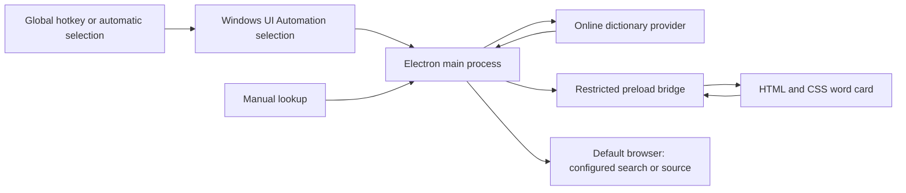

# Architecture

Windows-first Electron app with a React/TypeScript renderer. See decision 0001.

## Ownership

- electron/main.mjs: tray lifecycle, shortcut, selection helper invocation,
  persistent preferences, trusted IPC, native positioning, and browser opening.
- electron/provider.mjs: fixed HTTPS endpoint, bounded queries/responses,
  timeouts, error normalization, and external URL validation.
- native/SelectionHost.cs: warm, bounded Windows UI Automation and System.Speech helper.
  Reads selected ranges only; no clipboard access or simulated Ctrl+C.
- electron/selection-host.mjs: JSON-line IPC, request deadlines, process watchdog.
- electron/preload.cjs: narrowly typed operations and one selection event.
- src/dictionary.ts: untrusted response normalization into independent senses.
- src/App.tsx: loading/error/content/settings state; provider text rendered as text.
- src/brand/tokens.css: canonical design tokens; CSS owns presentation. Bundled font files have no network dependency.

The browser preview has a development-only bridge fallback to the same provider.
It does not claim desktop capabilities. The desktop performs requests in main,
not via a generic renderer HTTP or shell API.

Settings validation/migration lives in electron/settings.mjs; shared/search.mjs
owns search templates and encoding; electron/tray.mjs owns the menu definition.
Radix primitives supply dropdown/tooltip interaction, while locally bundled
Manrope and project CSS tokens own the approved compact presentation. Appearance
is persisted and synchronized with nativeTheme and a renderer data attribute.
Settings writes are queued and atomic, with main-process change events keeping
the tray and renderer synchronized. See docs/search-settings.md.

## Data flow and privacy

A warm .NET Framework helper captures the foreground selection before the explicit
shortcut opens the card. It checks the cursor/focus ancestor chains, the visible
document, and a bounded subtree because Chromium selections may not own keyboard
focus. UIA work is isolated from Electron; a 3-second busy watchdog and 3.5-second
request deadline terminate an unresponsive helper. No selected text is logged.

Automatic selection is opt-in. Foreground-window UIA events and mouse/Shift releases
schedule a debounced selected-range capture. The card uses showInactive, and the
renderer does not focus its input. Clicking activates it; the header is draggable.
Neither trigger reads or writes the clipboard. An unsupported selection opens
manual entry for the explicit shortcut; automatic failures stay silent.

Selected queries are limited to 80 characters and validated before networking.
Only the query goes to the dictionary. Response body maximum: 1 MB; request timeout:
10 seconds. Requests do not follow redirects. A new desktop request cancels the previous one;
the renderer ignores stale completions. No results are persisted or fabricated.

Text/audio URLs and licenses remain associated with the source entry. Related words at part-of-speech level are shown with a broader-scope note when
sense-specific relations are missing. Provider order is preserved.

Pronunciation tries approved recording URLs, then labeled Windows system speech.
System speech is an OS capability, not an offline dictionary. Dictionary content
still requires an online source. Settings group Appearance, Triggers, Word details,
and Search; each detail can be shown or hidden.

## Desktop boundary

Renderer: sandboxed, no Node, context isolation, restricted script CSP, inline style attributes for Radix positioning, no arbitrary
navigation or window creation, permission requests denied. Production assets are
served through wordpeek://app. The development URL is a fixed loopback origin.
IPC validates sender/frame and operation arguments. External navigation only accepts
constructed searches from validated saved presets/custom templates, or approved
HTTPS source/license hosts. Search IPC accepts a word, never an arbitrary URL.

The renderer requests a content height; main clamps it to 180–600 px and the
monitor work area. Short entries avoid a tall empty card. Window position is clamped to the cursor's monitor work area. Escape/blur hides
the card; tray Quit exits. An explicit trigger focuses the card for keyboard access after
selection capture; automatic triggers leave it inactive. dismissing does not restore the previous application's focus
explicitly in this prototype. Multi-monitor DPI and host-app compatibility need
native checks before a stable release.

## Deferred

Universal context-menu changes, persistent history,
offline dictionary packs, paid dictionary providers, context-aware meaning ranking,
auto-start, signed releases/updates, and other platforms. Do not imply these exist.
