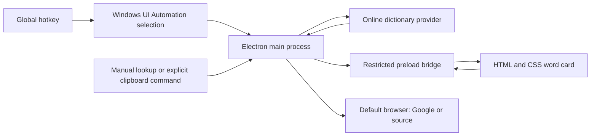

# Architecture

Windows-first Electron app with a React/TypeScript renderer. See decision 0001.

## Ownership

- electron/main.mjs: tray lifecycle, shortcut, selection helper invocation,
  persistent preferences, trusted IPC, native positioning, and browser opening.
- electron/provider.mjs: fixed HTTPS endpoint, bounded queries/responses,
  timeouts, error normalization, and external URL validation.
- electron/selection.ps1: reads selected ranges through UI Automation. No dynamic
  scripts or selected text in command arguments; no simulated Ctrl+C.
- electron/preload.cjs: narrowly typed operations and one selection event.
- src/dictionary.ts: untrusted response normalization into independent senses.
- src/App.tsx: loading/error/content/settings state; provider text rendered as text.
- src/brand/tokens.css: canonical design tokens; CSS owns presentation.

The browser preview has a development-only bridge fallback to the same provider.
It does not claim desktop capabilities. The desktop performs requests in main,
not via a generic renderer HTTP or shell API.

## Data flow and privacy

The hotkey starts an on-demand UIA helper with a five-second limit. An unavailable
selection opens manual entry; clipboard fallback requires opt-in. Explicit tray
clipboard lookup is user initiated. No polling or background clipboard hook exists.

Selected queries are limited to 80 characters and validated before networking.
Only the query goes to the dictionary. Response body maximum: 1 MB; request timeout:
10 seconds. Requests do not follow redirects. One desktop request runs at a time;
the renderer ignores stale completions. No results are persisted or fabricated.

Text/audio URLs and licenses remain associated with the source entry. Related words
at part-of-speech level are used only when that part of speech has one definition,
avoiding unsupported assumptions about matching senses. Provider order is preserved.

## Desktop boundary

Renderer: sandboxed, no Node, context isolation, restricted CSP, no arbitrary
navigation or window creation, permission requests denied. Production assets are
served through wordpeek://app. The development URL is a fixed loopback origin.
IPC validates sender/frame and operation arguments. External navigation only accepts
constructed Google queries or approved HTTPS source/license hosts.

The renderer requests a content height; main clamps it to 280–640 px and the
monitor work area. Short entries avoid a tall empty card. Window position is clamped to the cursor's monitor work area. Escape/blur hides
the card; tray Quit exits. Showing the card focuses it for keyboard access after
selection capture; dismissing does not restore the previous application's focus
explicitly in this prototype. Multi-monitor DPI and host-app compatibility need
native checks before a stable release.

## Deferred

Automatic selection triggers, universal context-menu changes, persistent history,
offline dictionary packs, paid dictionary providers, context-aware meaning ranking,
auto-start, signed releases/updates, and other platforms. Do not imply these exist.
